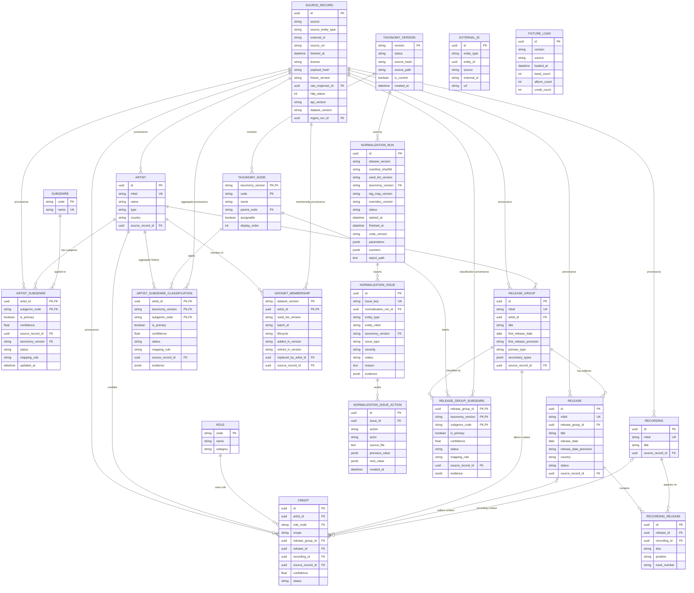

# Physical entity-relationship diagram

- **Status:** Current
- **Date:** 2026-11-08
- **Stage:** E2–E4
- **Schema:** Alembic `0006`

This diagram shows the physical catalog and normalization schema. It includes only real foreign-key relationships. `alembic_version` is omitted because Alembic owns it.

## Diagram

## How to read it

- `||--o{` means one-to-many with the left side required.
- `|o--o{` means the left side is optional for each credit: only release-scoped credits have a release, and only recording-scoped credits have a recording.
- `PK` is a primary key; `UK` is a unique key; `FK` is a foreign key.

## Relationships

| Relationship | Cardinality | Delete rule |
|---|---|---|
| `source_record` → `artist` | 1:N | `RESTRICT` |
| `source_record` → `artist_subgenre` | 1:N | `RESTRICT` |
| `source_record` → `release_group` | 1:N | `RESTRICT` |
| `source_record` → `release` | 1:N | `RESTRICT` |
| `source_record` → `recording` | 1:N | `RESTRICT` |
| `source_record` → `credit` | 1:N | `RESTRICT` |
| `artist` → `artist_subgenre` | 1:N | `CASCADE` |
| `subgenre` → `artist_subgenre` | 1:N | `RESTRICT` |
| `artist` → `release_group` | 1:N | `RESTRICT` |
| `release_group` → `release` | 1:N | `CASCADE` |
| `release` → `recording_release` | 1:N | `CASCADE` |
| `recording` → `recording_release` | 1:N | `CASCADE` |
| `artist` → `credit` | 1:N | `RESTRICT` |
| `role` → `credit` | 1:N | `RESTRICT` |
| `release_group` → `credit` | 1:N | `CASCADE` |
| `release` → `credit` | 1:N, optional | `RESTRICT` |
| `recording` → `credit` | 1:N, optional | `RESTRICT` |

The `credit.release_id` and `credit.recording_id` foreign keys use `RESTRICT` because the credit scope requires a target when the scope is `release` or `recording`. A target cannot be deleted silently while a credit depends on it.

## Tables without foreign-key relationships

| Table | Why it has no FK |
|---|---|
| `external_id` | Polymorphic: `entity_type` + `entity_id` can point to an artist, album, release or recording. Referential integrity is enforced by the loader, not by a single FK. |
| `fixture_load` | Operational metadata for a fixture load; it does not depend on domain rows. |

## Tables with no outgoing foreign keys

These tables are referenced by other tables but do not reference another table themselves:

- `source_record`
- `role`
- `subgenre`

`source_record` is the provenance root. `role` and `subgenre` are controlled vocabularies.

## Credit scope rules

The `credit` table supports three scopes:

| Scope | Required target | Forbidden target |
|---|---|---|
| `release_group` | `release_group_id` | `release_id`, `recording_id` |
| `release` | `release_id` and `release_group_id` | `recording_id` |
| `recording` | `recording_id` and `release_group_id` | — |

`release_group_id` is always present so every credit can be aggregated at album level. Recording-scoped credits are aggregated later with supporting-recording counts and ratios.

## E4 additions (migration `0005`)

- `taxonomy_version` and `taxonomy_node` preserve versioned taxonomy history; `subgenre` remains the current projection used by E2 read paths.
- `release_group_subgenre` stores versioned album classifications with one primary and optional secondary leaves.
- `artist_subgenre_classification` stores versioned band aggregate history; `artist_subgenre` remains the current projection.
- `dataset_membership` records active/retired membership per dataset.
- `normalization_run`, `normalization_issue` and `normalization_issue_action` record run lifecycle, review queue and audit actions.
- `source_record` gained optional E3 raw-response provenance fields; `recording_release` gained `track_number`.
- These additions do not rewrite historical E2/E3 data.

## E5 quality additions (migration `0006`)

- `quality_rule_catalogue` and `quality_rule` persist versioned quality rule metadata.
- `quality_run` records the selected normalization run, versions, status and counters.
- `quality_finding` records rule results and observations.
- `quality_exception` stores approved rule/entity exceptions with reason, approver and date.
- `quality_metric` stores completeness/coverage numerators, denominators and missing counts.
- Quality tables are read/write only to the quality batch; canonical and normalization tables are untouched.

## Related documents

- [Data model v0](data-model.md)
- [ADR-0004 — Release-group model](adr/ADR-0004-release-group-model.md)
- [ADR-0005 — Identity and provenance](adr/ADR-0005-identity-and-provenance.md)
- [ADR-0007 — Credit scope](adr/ADR-0007-credit-scope-and-recording-level-aggregation.md)
- [ADR-0008 — Taxonomy and corpus versioning](adr/ADR-0008-taxonomy-corpus-and-versioning.md)
- [E2 plan](../../specs/002-seed-band-explorer/plan.md)
